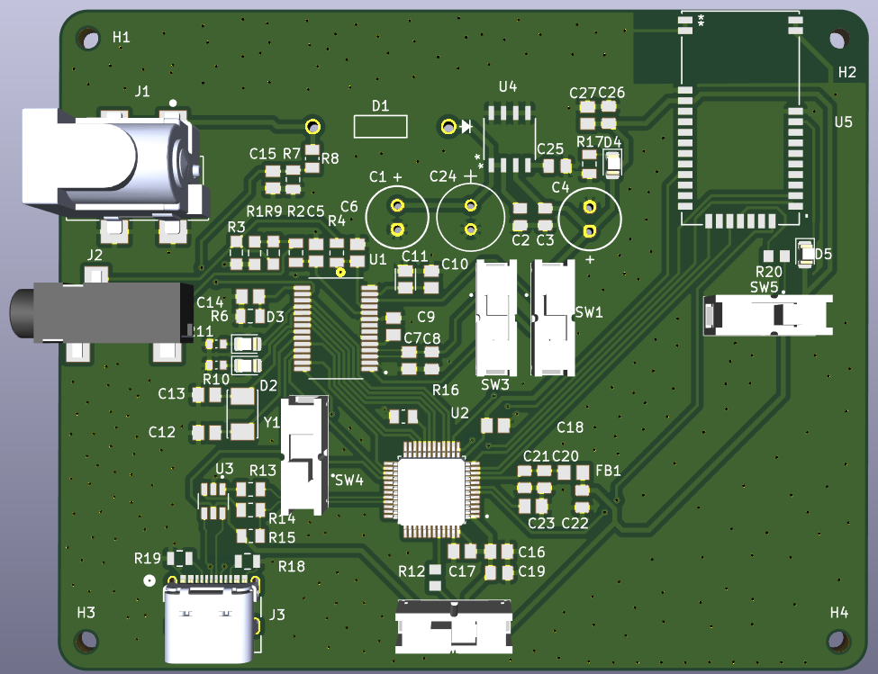
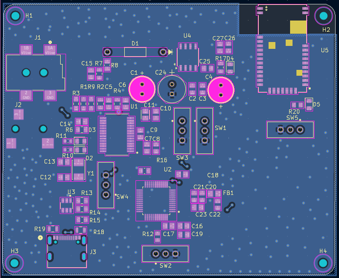
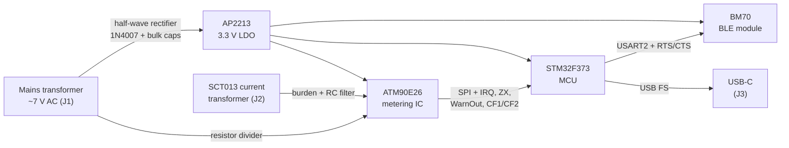

# Bluetooth Energy Meter PCB (OhmSprint 2026)

Hardware design of a single-phase **energy meter with Bluetooth Low Energy and USB**, built around the Microchip **ATM90E26** metering IC and an **STM32F373** microcontroller. Designed in **KiCad** by a team for **OhmSprint 2026**, a student hardware competition organized by **Meter&Control** in Belgrade.

**Result:** out of about 40 teams, the design was selected as one of the **10 finalists** whose boards were manufactured and assembled by the organizer. The final stage was board bring-up, firmware testing and verification of measurement accuracy on site.



| PCB layout (F.Cu red, B.Cu blue) | Schematic |
|---|---|
|  | [Open the schematic (PDF)](docs/OhmSprint_V1_schematic.pdf) |

---

## Contents

- [The task](#the-task)
- [My role](#my-role)
- [Hardware architecture](#hardware-architecture)
- [PCB](#pcb)
- [What I would improve in a V2](#what-i-would-improve-in-a-v2)
- [Repository layout](#repository-layout)

---

## The task

Design a device based on the **ATM90E26** metering chip and a microcontroller of our choice that precisely measures:

- RMS voltage and RMS current,
- line frequency,
- instantaneous active power,
- consumed active energy,

and presents the results through an interface of our choice (on-device display, or wired/wireless transfer to a phone or PC).

**Hardware requirements and how the design meets them:**

| Requirement | This design |
|---|---|
| Voltage input: secondary of a mains transformer, approx. 7 V RMS, via a **PJ-002AH-SMT-TR** connector | J1 = PJ-002AH; the same secondary also powers the board (allowed by the task) |
| Current measurement with an **SCT013** current transformer via an **SJ-3523-SMT-TR** connector | J2 = SJ-3523 3.5 mm jack, with burden resistors and an RC anti-aliasing filter |
| Schematic and PCB in **KiCad** | KiCad 10 |
| **2-layer** PCB, max. **15 × 15 cm** | 2 layers, **84.4 × 68.9 mm** |
| Smallest component size **0603** | No part smaller than 0603; most passives are 0805 |
| Organizer's design rules (0.1 mm clearance/track, 0.35 mm min. via, 0.3 mm copper-to-edge, …) | Entered exactly as given in the KiCad board setup, so DRC checks against them |
| Outputs: Gerbers (11 layers), drill files, BOM with MPN and manufacturer | [`fabrication/`](fabrication/), [`bom/`](bom/) |
| Total BOM cost **≤ 50 EUR**, parts from DigiKey | Parts selected from DigiKey |

---

## My role

Team of four: three hardware engineers and one developer who built the phone app.

- **Schematic:** drew almost the entire schematic (power supply, ATM90E26 metering front end, MCU, USB-C and BLE sections).
- **Component selection:** chose the main parts with the team; see [design decisions](#design-decisions).
- **PCB layout:** shared component placement and routing with one teammate.
- **Libraries:** imported and integrated the manufacturer symbols, footprints and 3D models.
- **Fabrication outputs:** generated the Gerber files, drill files and BOM with the team.

---

## Hardware architecture



| Block | Part | Notes |
|---|---|---|
| Metering | **ATM90E26** (Microchip) | Required by the task. 8.192 MHz crystal, SPI to the MCU; IRQ, zero-crossing (ZX), WarnOut and energy pulse outputs (CF1/CF2, also drive LEDs) |
| MCU | **STM32F373CCT6** (ST) | Arm Cortex-M4F; SPI master to the ATM90E26, USART2 with hardware flow control to the BLE module, USB full-speed device |
| Wireless | **BM70** (Microchip) | Bluetooth LE module for sending measurements to a phone; copper cutout under the antenna; mode and reset controlled from the MCU |
| Power | **AP2213-3.3** LDO | 3.3 V rail from the half-wave rectified transformer voltage (1N4007, 220 µF + 100 µF bulk) |
| USB | **USB4105** USB-C receptacle, **USBLC6-2SC6** ESD protection | 22 Ω series resistors on D+/D−, 1.5 kΩ D+ pull-up, 5.1 kΩ CC pull-downs (sink) |
| User I/O | 5 slide switches, 4 LEDs | Switches set the ATM90E26 configuration pins, STM32 BOOT0 and the BM70 mode |

Full parts list with manufacturer part numbers: [`bom/OhmSprint_V1_BOM.csv`](bom/OhmSprint_V1_BOM.csv).

### Design decisions

- **STM32F373 as the MCU:** a Cortex-M4 with a hardware floating-point unit for processing the measurement data, from an STM32 line that ST positions for precision analog measurement applications.
- **BM70 for Bluetooth LE:** we chose wireless transfer to a phone as the more challenging option for presenting the results. The BM70 is a complete BLE module controlled over a simple UART interface, so the MCU only needs to send data over serial instead of running a BLE stack.
- **LDO instead of a switching converter:** the board only needs a single 3.3 V rail at low current, so a linear regulator (AP2213) after the rectifier gives a simpler, low-noise supply with fewer parts and no switching layout concerns near the measurement front end.

---

## PCB

| | |
|---|---|
| Layers | 2 (F.Cu, B.Cu) |
| Size | 84.4 × 68.9 mm |
| Thickness | 1.6 mm |
| Ground | GND pour on both layers |
| Mounting | 4 × mounting holes |
| Tool | KiCad 10 |

**Design notes:**
- The BLE module sits at the board edge with a cutout under its antenna, so no copper detunes it.
- The STM32 analog supply (VDDA) is filtered from the 3.3 V rail through a ferrite bead.
- USB data lines run from the connector through the ESD protection IC and the series resistors to the MCU.
- The measurement inputs (transformer and current-transformer jacks) enter on the left edge; the BLE module sits on the opposite edge.

---

## What I would improve in a V2

- **Debug header:** route the STM32 SWD pins (SWDIO, SWCLK) together with NRST and GND to a small header, so the MCU can be programmed and debugged with a standard probe instead of only through the BOOT0 bootloader.
- **Test points:** add test points on the 3.3 V rail, the rectified input and the SPI and UART lines, to make bring-up measurements with an oscilloscope and multimeter faster.
- **USB power:** connect USB-C VBUS so the digital part (MCU, BLE) can be powered and programmed from a laptop without the mains transformer connected.

---

## Repository layout

```
├── README.md
├── kicad/                       # KiCad 10 project
│   ├── OhmSprint_V1.kicad_pro
│   ├── OhmSprint_V1.kicad_sch
│   ├── OhmSprint_V1.kicad_pcb
│   ├── Symbols/                 # imported manufacturer symbols
│   ├── Footprints/              # imported manufacturer footprints
│   └── 3D_models/               # STEP models
├── fabrication/
│   ├── gerbers/                 # Gerber files (2 layers)
│   └── drill/                   # PTH and NPTH drill files
├── bom/OhmSprint_V1_BOM.csv
└── docs/
    ├── OhmSprint_V1_schematic.pdf
    └── img/
        ├── pcb_3d.png           # 3D view of the assembled board
        └── pcb_layout.png       # copper layout, both layers
```

To open the project, install **KiCad 10** and open `kicad/OhmSprint_V1.kicad_pro`.
